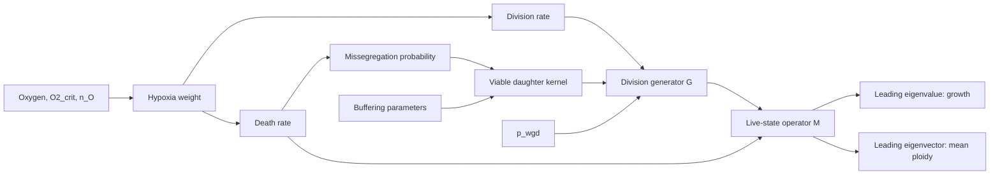

# Separate in-vivo fixed-oxygen model: parameter and equation map

This is a mechanistic equation audit, not a completed structural-identifiability proof.
The canonical model is `model_O2_supply_demand_MAP.cpp`, with N=22,...,154,
N_UNIT=22 and diploid chromosome-copy reference 44. The in-vivo configuration
enables O2_growth and uses ploidy_O2_death="ploidy_related".

## Rates and shared pathways

For oxygen O (percent), h(O)=C^n/(C^n+O^n), with C=O2_crit and n=n_O.
Growth: lambda_N=lam_max/[1+alpha_o2*h(O)*(N/44)^gamma_growth].
Death: mu_N=mu_hp*h(O)*(N/44)^gamma_mu.
Missegregation: p_N=clip01[p_mis_base+p_misseg*mu_N/(mu_N+k_o_mis)].
Thus the death module explicitly feeds the missegregation module. At O=0,
h=1 for all allowed C,n, so both oxygen-shape parameters are inactive at that
specific oxygen condition; their interaction estimates should be near zero
within numerical/sampling error.

For m missegregated copies and parent N, s_N=clip01[buffer_smax*
exp(-buffer_beta*(44/N)^buffer_n_exp)]. Survival is s_N^m for m>0 and 1 for m=0.
Binomial weights Binomial(m;N,p_N) multiply this survival and populate the
gain/loss daughter shifts N+m and N-m symmetrically. Kernel tail truncation
and the configured state-boundary rule remain exactly those of the fitted model.
The kernel weights represent expected viable daughter numbers, not a
renormalized conditional probability distribution.

WGD weight is lambda_N*p_wgd; the ordinary division-kernel weight is
lambda_N*(1-p_wgd). The code deposits the WGD contribution at 2N and removes
the mother at rate lambda_N. In schematic matrix form,
G[q,N]=lambda_N*((1-p_wgd)*K[q,N]+p_wgd*B[q,N])-lambda_N*delta[q,N],
with K and B including the original boundary handling.
M=G-diag(mu_N); dx/dt=Mx at fixed oxygen.

## Outputs

Growth r=max Re(eigenvalues(M)), in day^-1.
Dominant mean ploidy=sum_N (N/22)*v_N, where Mv=rv and sum(v)=1.
The Sobol evaluator uses this unchanged canonical matrix, checks the eigenpair
residual and nonnegativity, and records 50/100-digit recovery if required.

Parameters interact through rate products, saturation, offspring survival,
channel weighting and the eigenvalue/eigenvector map. Co-occurrence in an
equation is a mechanistic link; it does not prove a large second-order Sobol
component. The 91-pair table records candidate links before numerical analysis.

## Scope and identifiability

o2_S0, kappa_O, eta_o2 and k_clear do not enter this fixed-O2 live-state operator.
The parameter-equation map is not a claim that the 14 active parameters are
individually identifiable. COMBOS/StructuralIdentifiability analyses would
require a specified observation model and a separate audit of the model's
non-rational parameter functions.
